  <picture>
    <source media="(prefers-color-scheme: dark)" srcset="assets/hero-dark.svg">
    
  </picture>

I write payments software for a living. Everything public here is an experiment: built to answer one question, then left as it was.

| Experiment | The question it asked |
| :-- | :-- |
| [**gwt**](https://github.com/slowestmonkey/gwt) | Can several coding agents work in one repo without colliding? |
| [**opendiff**](https://github.com/slowestmonkey/opendiff) | Can you review an agent's diff while it is still writing? |
| [**fractal**](https://github.com/slowestmonkey/fractal) | Can you verify generated code by reading behaviours instead of code? |
| [**sauntrakai**](https://github.com/slowestmonkey/sauntrakai) | Can generated music be steered while it plays? |
| [**spacer**](https://github.com/slowestmonkey/spacer) | Does the fear of losing your spaceship beat a reward for hitting a step goal? |
| [**podcut**](https://github.com/slowestmonkey/podcut) | Can AI find the five minutes worth hearing in a long podcast? |

None of these are maintained. The answers are in each README.
